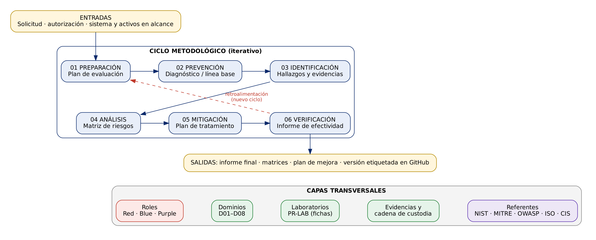

# PRISMA — Framework metodológico de ciberseguridad

Purple Reconocimiento, Identificación, Seguridad, Mitigación y Análisis. Versión 0.2 (noviembre de 2026).

Autores: Edison Javier Gonzalez Velosa, Cristian René Chaves Tamayo y Brayan Matheo Puentes Jaimes — Electiva de Ciberseguridad, Universidad Santo Tomás.

Marco metodológico de seis fases (Preparación, Prevención, Identificación, Análisis, Mitigación, Verificación) que integra Red Team, Blue Team y Purple Team. Documento completo: `docs/PRISMA_Framework_Metodologico_v0.2.docx`.

> Uso exclusivamente autorizado: laboratorios aislados o sistemas propios. No se publican credenciales, datos personales ni artefactos que afecten objetivos reales.

## Catálogo de laboratorios
| ID | Laboratorio | Dominio | Enfoque |
|---|---|---|---|
| PR-LAB-001 | Comandos Shell y Kali Linux | D01 | Transversal |
| PR-LAB-002 | DNS Footprinting con nslookup y dig | D02 | Ofensivo controlado |
| PR-LAB-003 | Clonación controlada HTTrack | D03 | Ofensivo/defensivo |
| PR-LAB-004 | Esteganografía con Steghide: partes 1–3 | D06 | Forense y colaborativo |
| PR-LAB-005 | Ingeniería social: principios | D05 | Factor humano |
| PR-LAB-006 | Maltego: instalación y aplicación | D02 | OSINT |
| PR-LAB-007 | Burp Suite | D03/D04 | Pruebas web |
| PR-LAB-008 | Laboratorio 1 de Ciberseguridad: escáner de puertos, psutil y cabeceras HTTP (Python) | D02/D03 | Ofensivo controlado |
| PR-LAB-009 | Unidad 4 · Labs 1–2: superficie de exposición y estados de puerto (Red/Blue) | D02/D07 | Purple |
| PR-LAB-010 | Unidad 4 · Labs 3–4: inventario autorizado vs. servicios observados y configuraciones débiles | D01/D07 | Defensivo |
| PR-LAB-011 | Unidad 4 · Lab 5: tráfico en claro frente a tráfico cifrado (Wireshark) | D04 | Defensivo |
| PR-LAB-012 | Unidad 4 · Labs 6–8: simulador de filtrado, auditor de reglas e iptables | D07 | Defensivo |
| PR-LAB-013 | Unidad 4 · Labs 9–12: fuerza bruta SSH, detección de escaneo, mini-SIEM y análisis de incidentes | D07 | Defensivo |
| PR-LAB-014 | Unidad 4 · Lab 13: integrador Red Team frente a Blue Team | D02/D07 | Purple |
| PR-LAB-015 | Laboratorio 2: hash, reinicio auditable, phishing, multibanner, riesgos, NVD e indicador | D04/D05/D06/D07 | Purple |
| PR-LAB-016 | Laboratorio 3: permisos, política de contraseñas, bcrypt, cifrado Fernet, hardening SSH, usuarios y exposición | D01/D07 | Defensivo |
| PR-LAB-017 | Taller Unidad 5: reconocimiento, escaneo y análisis de vulnerabilidades | D02 | Ofensivo controlado |
| PR-LAB-018 | Taller de comandos Kali Linux (Unidad 5) | D01 | Transversal |
| PR-LAB-019 | DockerLabs · Perrito Mágico: writeup de API y CSRF | D03/D04 | Ofensivo controlado |
| PR-LAB-020 | Caso de estudio: auditoría interna de NubeSegura S.A. | D02/D04/D05/D06/D07 | Purple (integrador) |
| PR-LAB-021 | Análisis de herramientas SayCheese y TBomb (phishing y spam SMS) | D05 | Factor humano |
| PR-LAB-022 | Marcos normativos: ISO 27001, NIST CSF, OWASP, PCI DSS, HIPAA y CIS Controls | D07 | Documental / cumplimiento |

## Estructura
`docs/` documento y esquemas · `framework/` fases, protocolos y matrices · `laboratorios/` una carpeta por laboratorio con su ficha · `casos-estudio/` evidencias del caso NubeSegura · `scripts/`, `plantillas/`, `resultados/`.
